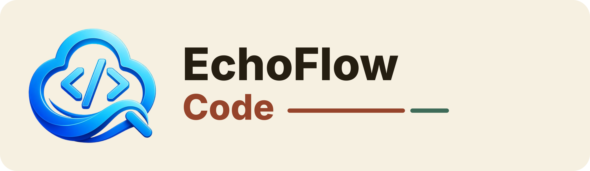

# EchoFlow Code

  <picture>
    <source media="(prefers-color-scheme: dark)" srcset="docs/images/logo-horizontal-dark.svg">
    
  </picture>

[English](README.en.md) · [简体中文](README.zh-CN.md)

EchoFlow Code is a **local-first desktop workspace for Claude Code and model providers** on macOS, Windows, and Linux. Run coding sessions, inspect every diff, coordinate Agent Teams and Dynamic Workflows, and keep control of every tool call and model connection.

[Download desktop app](https://github.com/LiuGuangHS/EchoFlow-ClaudeCode/releases/latest) · [Start in five minutes](docs/en/start/first-session.md) · [Documentation](https://code.echoflow.cn) · [Feedback and discussions](https://github.com/LiuGuangHS/EchoFlow-ClaudeCode/discussions)

## Install

1. Download the installer for your operating system and architecture from [EchoFlow Releases](https://github.com/LiuGuangHS/EchoFlow-ClaudeCode/releases).
2. Configure your model provider, API key, and default model in Settings.
3. Check the release's signing status before installing. See the [installation guide](docs/en/start/install.md), [code signing policy](docs/en/start/code-signing.md), and [privacy and network access](docs/en/start/privacy.md).
4. For phone access, see [Mobile app and remote connection](docs/en/desktop/remote.md). Mobile package availability must be checked against EchoFlow Releases; upstream APKs and TestFlight groups are not EchoFlow distribution channels.

## Desktop Highlights

- **Multi-session workspace and global search**: tabs, project switching, terminal entry, resizable sidebar, and session history; Cmd+K searches across sessions and jumps to a match.
- **Branch / Worktree launch**: choose a repository branch and use the current working tree or an isolated Worktree.
- **File-by-file review**: syntax-highlighted diffs, line-level feedback, and an undo path keep every change inspectable.
- **Built-in browser preview**: verify edited pages inside the app with real cookies and login state.
- **Five permission modes**: approve commands, tool calls, and follow-up questions in the GUI, or select planning and other permission modes.
- **Bring your own model**: official Claude, ChatGPT, and Grok sign-in; vendor APIs, presets, LM Studio, Ollama, and compatible custom endpoints.
- **Image generation**: generate and edit images through ChatGPT / Grok sign-in or an OpenAI-compatible Images API.
- **Visual MCP manager**: STDIO / Streamable HTTP / SSE transports with project-private, shared, and global scopes.
- **Six colour themes**: white, paper, warm classic, celadon, ink night, and ink blue, optionally following system appearance.
- **Skill marketplace**: discover, preview, and install third-party ClawHub / SkillHub skills, with source and safety status visible before installation.
- **Session activity and SubAgents**: inspect task progress, background tasks and sources; configure SubAgent models, tools, and permissions visually.
- **Agent Teams workbench**: members, shared tasks, communication, dependency lanes, and completed-session history in one place.
- **Dynamic Workflow orchestration**: model-written scripts coordinate parallel or pipeline subagents with phase views, interrupts, and resume.
- **Model trace and diagnostics**: local request status and timing, searchable failure evidence, upgrade-safe persistence, and controlled repair paths.
- **Computer Use**: native desktop control on macOS / Windows / Linux without Python. macOS retains its native engine; Windows / Linux reuse agent-desktop. Supported background semantic actions leave the physical pointer alone; physical input still uses the foreground and remains subject to OS limits. Enabling and confirming consent authorizes all supported apps.
- **Desktop pets**: Dada, Huhu, Bubu, and Huihui reflect task state, with custom pets supported (off by default).
- **Mobile app and H5**: QR pairing lets a phone approve tools, answer questions, start tasks, review changes, or stop work. Tasks run on the computer, so locking the phone does not interrupt them. The upstream mobile implementation requires desktop v0.7.6 or later; this is not an EchoFlow release-version promise.
- **IM integration**: Telegram / Feishu / WeChat / DingTalk / WhatsApp / WeCom / QQ / Slack support remote chat, project switching, and permission approval.
- **Scheduled tasks and usage stats**: run planned tasks in independent sessions and track local token usage.

## Documentation

Full documentation: <https://code.echoflow.cn>

| Area | Documents |
|---|---|
| Getting started | [Overview](docs/en/start/index.md) · [Install](docs/en/start/install.md) · [Models](docs/en/start/models.md) · [First session](docs/en/start/first-session.md) · [Troubleshooting](docs/en/start/troubleshooting.md) |
| Desktop | [Overview](docs/en/desktop/index.md) · [Computer Use](docs/en/desktop/computer-use.md) · [Pets](docs/en/desktop/pets.md) · [Mobile, H5 and IM](docs/en/desktop/remote.md) |
| IM | [Pairing and platforms](docs/en/im/index.md) |
| CLI | [Setup](docs/en/cli/index.md) · [Reference](docs/en/cli/reference.md) · [Environment](docs/en/cli/env.md) |
| Internals | [Desktop](docs/en/internals/desktop.md) · [Agents and Teams](docs/en/internals/agent.md) · [Skills](docs/en/internals/skills.md) · [Memory](docs/en/internals/memory.md) · [Computer Use](docs/en/internals/computer-use.md) · [Server API](docs/en/internals/server.md) · [Channels](docs/en/internals/channel.md) · [Structure](docs/en/internals/structure.md) · [Contributing](docs/en/internals/contributing.md) |

## Feedback

Use [Discussions](https://github.com/LiuGuangHS/EchoFlow-ClaudeCode/discussions) for questions and ideas, and [Issues](https://github.com/LiuGuangHS/EchoFlow-ClaudeCode/issues) for reproducible bugs. Read [SUPPORT.md](SUPPORT.md) before sharing logs and [SECURITY.md](SECURITY.md) for vulnerabilities.

## Stack and acknowledgements

TypeScript, Electron, React + Vite, Bun, React + Ink, Commander.js, Anthropic SDK, MCP, and LSP.

- [React](https://github.com/facebook/react) and [Electron](https://github.com/electron/electron): UI ecosystem and cross-platform desktop capabilities.
- [cc-haha](https://github.com/NanmiCoder/cc-haha) by NanmiCoder: upstream source; its attribution and applicable license terms remain in place.
- [agent-desktop](https://github.com/vercel-labs/agent-desktop) by Vercel Labs: directly reused Windows / Linux native implementation, pinned to **1.0.2**, commit [`9eb9b296192fcb70bda25e918cd6dd66abfa3d0d`](https://github.com/vercel-labs/agent-desktop/tree/9eb9b296192fcb70bda25e918cd6dd66abfa3d0d). Retained [Apache-2.0 license](native/agent-desktop/LICENSE), [provenance and hashes](native/agent-desktop/UPSTREAM.json), and [local changes](native/agent-desktop/PATCHES.md).
- [cc-switch](https://github.com/farion1231/cc-switch): model provider configuration references.
- [LINUX DO](https://linux.do/): community practices and inspiration.

## License

The root [LICENSE](LICENSE) reserves all rights in original EchoFlow Code work only. Permission for that work requires a separate written agreement signed by LiuGuangHS / EchoFlow Code. It does not license third-party code and is not a full end-user license agreement.

Reused agent-desktop code retains its Apache-2.0 license. Other third-party code and dependencies retain their applicable licenses and notices; see [Third-Party Licenses](THIRD_PARTY_LICENSES.md) and the notices alongside the source.
