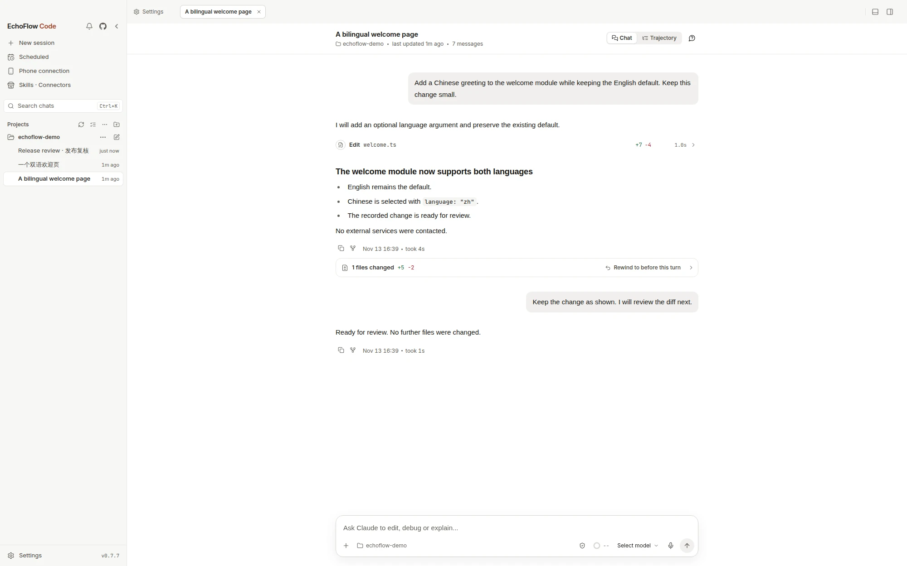
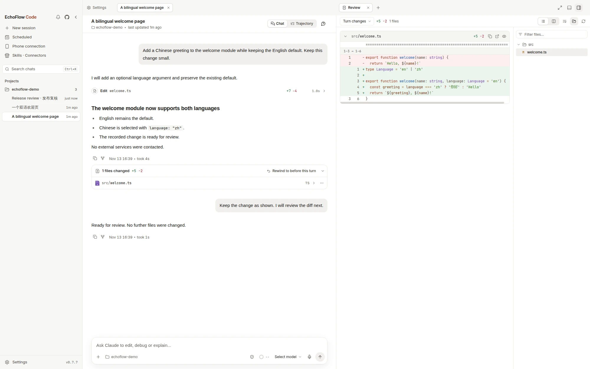
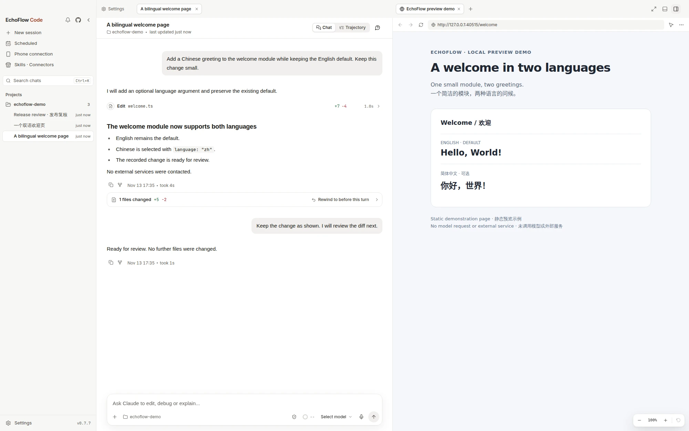
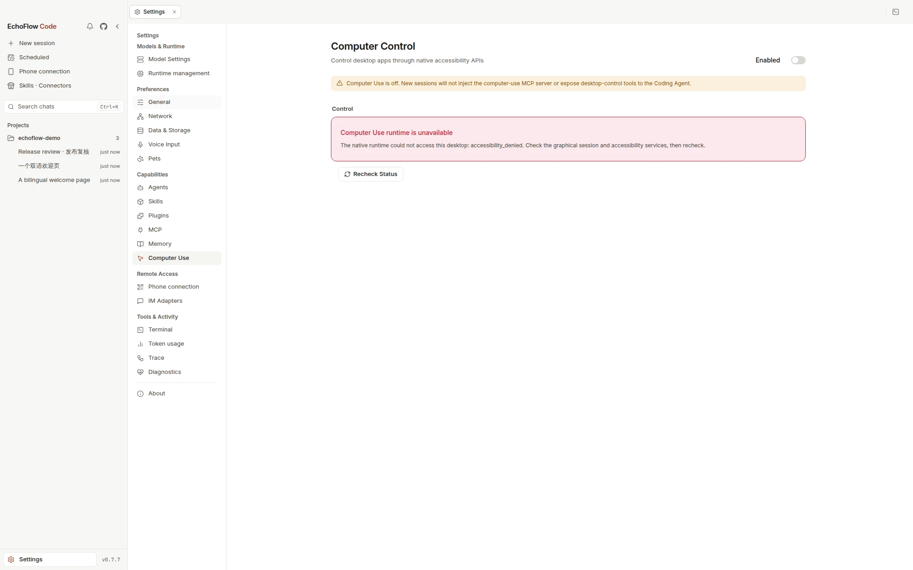
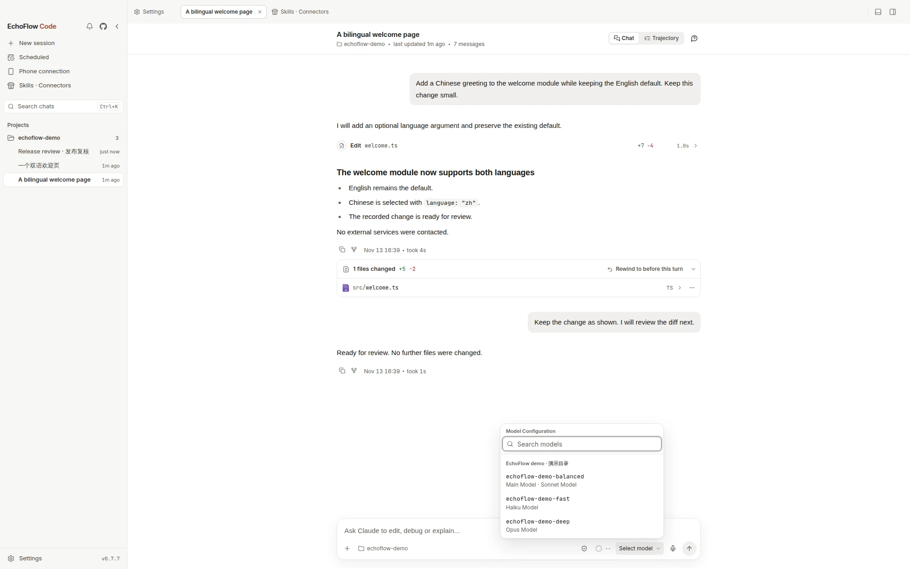
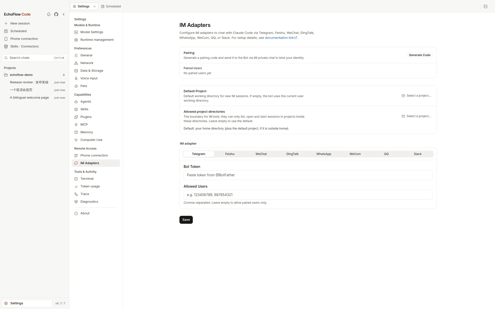

# EchoFlow Code: a local-first desktop client for Claude Code

<p align="center">
  <picture>
    <source media="(prefers-color-scheme: dark)" srcset="docs/images/logo-horizontal-dark.svg">
    
  </picture>
</p>

<div align="center">

[](https://github.com/LiuGuangHS/EchoFlow-ClaudeCode/releases/latest)
[](https://code.echoflow.cn/en/download)
[](https://github.com/LiuGuangHS/EchoFlow-ClaudeCode/blob/main/LICENSE)
[](https://code.echoflow.cn/en)
[](README.zh-CN.md)

**English** · [简体中文](README.zh-CN.md)

</div>

**EchoFlow Code is a local-first desktop client (GUI) for Claude Code on macOS, Windows and Linux.** It turns a coding agent into something you can watch and steer: Agent Teams work in parallel on a visible canvas, review changes file by file and undo supported turns, permission requests can be approved from your phone or a chat app, and you choose the model.

[**Download**](https://code.echoflow.cn/en/download) · [**Start your first session**](https://code.echoflow.cn/en/start/first-session) · [Documentation](https://code.echoflow.cn/en) · [Discussions](https://github.com/LiuGuangHS/EchoFlow-ClaudeCode/discussions)

## At a glance

| | |
| --- | --- |
| **What it is** | A desktop GUI for Claude Code with an Agent Teams workbench, Dynamic Workflow orchestration, per-file diff review, Computer Use, and phone or chat-app approval |
| **Platforms** | macOS, Windows and Linux desktop apps; an Android client for remote access |
| **Models** | Official Claude, ChatGPT and Grok sign-in; vendor APIs (presets for DeepSeek, Kimi and Zhipu GLM); local models through LM Studio or Ollama; compatible custom endpoints |
| **Data** | Local-first. Sessions, settings and memory stay on your machine, and the project runs no cloud backend that receives session content |
| **Price** | Free to download. Model usage is billed by the provider you choose; local model costs depend on the model and infrastructure |
| **License** | Source-available, all rights reserved (original work only). Not open source. See [License](#license) |
| **Interface languages** | Simplified Chinese, Traditional Chinese, English, Japanese, Korean |
| **Website and docs** | https://code.echoflow.cn/en |
| **Download** | https://code.echoflow.cn/en/download or [GitHub Releases](https://github.com/LiuGuangHS/EchoFlow-ClaudeCode/releases) |

## What sets it apart

### Watch multi-agent work as it happens

The **Agent Teams workbench** shows team members, a shared task list, a communication feed and dependency lanes on one canvas. Tasks blocked by an unfinished prerequisite are flagged, members can have different model and runtime settings, and human review is supported. **Dynamic Workflow** lets the agent write an orchestration script on the fly and run subagents in parallel or in a pipeline, with a phase view, interrupt and resume. See [Agent Teams](https://code.echoflow.cn/en/desktop/agent-teams) and [Dynamic Workflow](https://code.echoflow.cn/en/desktop/dynamic-workflow).

### Review and undo every change

Permission requests, tool calls and workspace diffs stay visible. Open any changed file for a syntax-highlighted diff, leave line-level comments, undo a whole turn, and preview the edited page in the built-in browser. Five permission modes range from “ask every time” to “skip permissions”. See [Workspace](https://code.echoflow.cn/en/desktop/workspace).

### Computer Use that stays out of your way (macOS)

On macOS 14.4 and later, the native runtime operates other apps in the background through a separate virtual cursor, so your real mouse and keyboard stay free (a few actions may change app focus). On Windows the compatibility executor moves the real mouse, and Linux has no executor yet. Enabling it requires in-app consent and system permissions. See [Computer Use](https://code.echoflow.cn/en/desktop/computer-use).

### Approve from your phone or chat app

Scan a QR code to continue the same session in your phone browser (H5), use the Android client, or chat and approve actions through Telegram, Feishu, WeChat, DingTalk, WhatsApp, WeCom, QQ or Slack. The desktop app must be running, because tasks execute on your computer. See [Phone and IM relay](https://code.echoflow.cn/en/desktop/remote) and [messaging integrations](https://code.echoflow.cn/en/im).

### Bring your own model

Sign in with an official Claude, ChatGPT or Grok account, use vendor API presets such as DeepSeek, Kimi and Zhipu GLM, run local models through LM Studio or Ollama, or connect a compatible custom endpoint. Credentials, model selection and permissions stay under your control. Full agent workflows need a model that supports tool calling. See [Connect a model](https://code.echoflow.cn/en/start/models).

## More desktop features

- **Multi-session workspace**: tabs, project switching, a terminal entry, session history, archiving, and highlights for sessions waiting on you.
- **Global search**: press Cmd+K to search every session and jump to the match.
- **Branch and Worktree launch**: pick a branch and choose between the current working tree and an isolated Worktree.
- **Project instructions**: reads project-level `AGENTS.md` files.
- **Visual MCP manager**: add and edit MCP servers over STDIO, Streamable HTTP or SSE, with project, shared or global scope.
- **Skill marketplace**: discover, preview and install third-party skills from ClawHub and SkillHub, with source and safety status shown first.
- **Visual SubAgent manager**: create and tune subagents with their own model, tools and permission mode.
- **Scheduled tasks and usage stats**: run planned tasks in their own sessions and track local token usage.
- **Model trace**: every model request is logged locally with status and timing, so stuck or failed calls are easy to diagnose.
- **Image generation and voice dictation**: generate and edit images in chat, and dictate into the composer.
- **Config sharing**: import provider configuration from a trusted `echoflowcode://` link.
- **Themes and pets**: six colour themes that can follow the system light or dark setting, plus optional desktop pets that show task progress.

## Desktop preview

|  |  |  |
| --- | --- | --- |
| **Follow work as it runs**<br>Tool calls and progress stay in view | **Review every change**<br>Focused syntax-highlighted diffs | **Verify on the spot**<br>Open the real edited page in the app |

|  |  |  |
| --- | --- | --- |
| **Operate other apps**<br>Computer Use with clear permission status | **Choose the exact model**<br>Providers, presets and local endpoints together | **Approve from chat apps**<br>Connect messaging platforms to the desktop |

## Install the desktop app

1. Download the macOS, Windows or Linux installer from the [download page](https://code.echoflow.cn/en/download) or [Releases](https://github.com/LiuGuangHS/EchoFlow-ClaudeCode/releases).
2. Configure a model provider, API key and default model in Desktop Settings.
3. Public macOS releases require signing and notarization. Draft or unsigned builds may require one-time manual approval. Unsigned Windows installers can show SmartScreen; choose “More info” then “Run anyway.” See the [installation guide](https://code.echoflow.cn/en/start/install).

## Run the CLI from source

```bash
bun install
cp .env.example .env
./bin/echoflow-code
```

See [environment variables](https://code.echoflow.cn/en/cli/env) and [CLI setup](https://code.echoflow.cn/en/cli) for configuration details.

## Frequently asked questions

### Is EchoFlow Code free?

It is free to download. Model services are not included: subscriptions and API usage are billed by the provider you choose, and local model costs depend on the model and infrastructure. The source of the original work is publicly viewable, but EchoFlow Code is not open source (see [License](#license)).

### Do I need to install Claude Code first?

No. The CLI core is bundled in the desktop installer, so you do not need Node.js, npm or a global command. The terminal version is also available from this repository; see the [CLI guide](https://code.echoflow.cn/en/cli).

### Which operating systems are supported?

macOS, Windows and Linux, with Intel / AMD and ARM builds. Choose the right package on the [download page](https://code.echoflow.cn/en/download). Background Computer Use is limited to macOS.

### Can I use DeepSeek, Kimi or Zhipu GLM with Claude Code through EchoFlow Code?

Yes. EchoFlow Code ships presets for DeepSeek, Kimi and Zhipu GLM, and it can also connect to LM Studio, Ollama or any compatible custom endpoint. Available models depend on your account and provider, and agent workflows need tool-calling support. See [Connect a model](https://code.echoflow.cn/en/start/models).

### Does my code or session data leave my machine?

Sessions, settings, memory, skills and logs are stored locally, mostly under `~/.claude`. The project runs no cloud backend that receives session content. The app is not fully offline: prompts, attachments, selected code context and tool results go to the model provider you choose, and enabled integrations and other configured services may also receive data. See [Privacy and network access](https://code.echoflow.cn/en/start/privacy).

### Will Computer Use take over my mouse?

On macOS 14.4 and later it does not: the native runtime uses a separate virtual cursor. On Windows the compatibility executor moves the real mouse, and Linux has no executor yet. See [Computer Use](https://code.echoflow.cn/en/desktop/computer-use).

### Can I approve permission requests from my phone?

Yes. Use H5 access (scan a QR code), the Android client, or one of the supported chat platforms. The desktop app must be running, because the task executes on your computer. See [Phone and IM relay](https://code.echoflow.cn/en/desktop/remote).

### How does it relate to the Claude Code CLI?

The desktop app is a graphical interface around the `echoflow-code` CLI core in this repository. Permission approval, subagents, Skills, MCP and memory work in the GUI as they do in the terminal, and the desktop adds diff review, the Agent Teams workbench, session history and remote approval.

### Can I modify or redistribute EchoFlow Code?

Not without written permission. The source is viewable for review, but all rights are reserved: copying, modification, redistribution, sublicensing and commercial use require a separate written agreement. See [License](#license).

## Documentation

Full documentation: <https://code.echoflow.cn/en>. A machine-readable index for AI assistants is at [llms.txt](https://code.echoflow.cn/llms.txt).

| Area | Documents |
|------|-----------|
| Getting started | [Install](https://code.echoflow.cn/en/start/install) · [Connect a model](https://code.echoflow.cn/en/start/models) · [First session](https://code.echoflow.cn/en/start/first-session) · [Troubleshooting](https://code.echoflow.cn/en/start/troubleshooting) · [Privacy](https://code.echoflow.cn/en/start/privacy) |
| Desktop | [Overview](https://code.echoflow.cn/en/desktop) · [Agent Teams](https://code.echoflow.cn/en/desktop/agent-teams) · [Dynamic Workflow](https://code.echoflow.cn/en/desktop/dynamic-workflow) · [Computer Use](https://code.echoflow.cn/en/desktop/computer-use) · [Skills](https://code.echoflow.cn/en/desktop/skills) · [Scheduled tasks](https://code.echoflow.cn/en/desktop/schedule) · [Phone and IM relay](https://code.echoflow.cn/en/desktop/remote) |
| Practical guides | [Fix a bug](https://code.echoflow.cn/en/cases/fix-bug) · [Explore a project](https://code.echoflow.cn/en/cases/explore-project) · [Continue on your phone](https://code.echoflow.cn/en/cases/phone-handoff) · [All guides](https://code.echoflow.cn/en/cases) |
| Messaging | [Overview](https://code.echoflow.cn/en/im) · [Telegram](https://code.echoflow.cn/en/im/telegram) · [Feishu](https://code.echoflow.cn/en/im/feishu) · [Slack](https://code.echoflow.cn/en/im/slack) |
| CLI | [Setup](https://code.echoflow.cn/en/cli) · [Reference](https://code.echoflow.cn/en/cli/reference) · [Environment](https://code.echoflow.cn/en/cli/env) |
| Internals | [Desktop architecture](https://code.echoflow.cn/en/internals/desktop) · [Agents](https://code.echoflow.cn/en/internals/agent) · [Skills](https://code.echoflow.cn/en/internals/skills) · [Server API](https://code.echoflow.cn/en/internals/server) · [Contributing](https://code.echoflow.cn/en/internals/contributing) |

## Feedback and discussions

Use [Discussions](https://github.com/LiuGuangHS/EchoFlow-ClaudeCode/discussions) for questions, ideas and usage notes. Use [Issues](https://github.com/LiuGuangHS/EchoFlow-ClaudeCode/issues) for reproducible bugs. Read [SUPPORT.md](SUPPORT.md) before sharing logs, and use [SECURITY.md](SECURITY.md) for vulnerabilities.

## Stack

| Category | Technology |
|----------|------------|
| Language | TypeScript |
| Desktop | Electron |
| Desktop UI | React + Vite |
| Local runtime | [Bun](https://bun.sh) |
| Terminal UI | React + [Ink](https://github.com/vadimdemedes/ink) |
| CLI parsing | Commander.js |
| API | Anthropic SDK |
| Protocols | MCP, LSP |

## License

EchoFlow Code is **source-available, not open source.** The source of the original work in this repository is publicly viewable for review, but all rights are reserved: copying, modification, redistribution, sublicensing and commercial use require a separate written agreement (see [LICENSE](LICENSE)). Portions of the code are derived from third-party sources and are not covered by that license; see [THIRD_PARTY_LICENSES.md](THIRD_PARTY_LICENSES.md). Claude and Claude Code are trademarks of Anthropic, PBC. EchoFlow Code is not affiliated with or endorsed by Anthropic.

## Acknowledgements

- [React](https://github.com/facebook/react): UI ecosystem and component model.
- [Electron](https://github.com/electron/electron): cross-platform desktop capabilities.
- [cc-switch](https://github.com/farion1231/cc-switch): provider configuration references.
