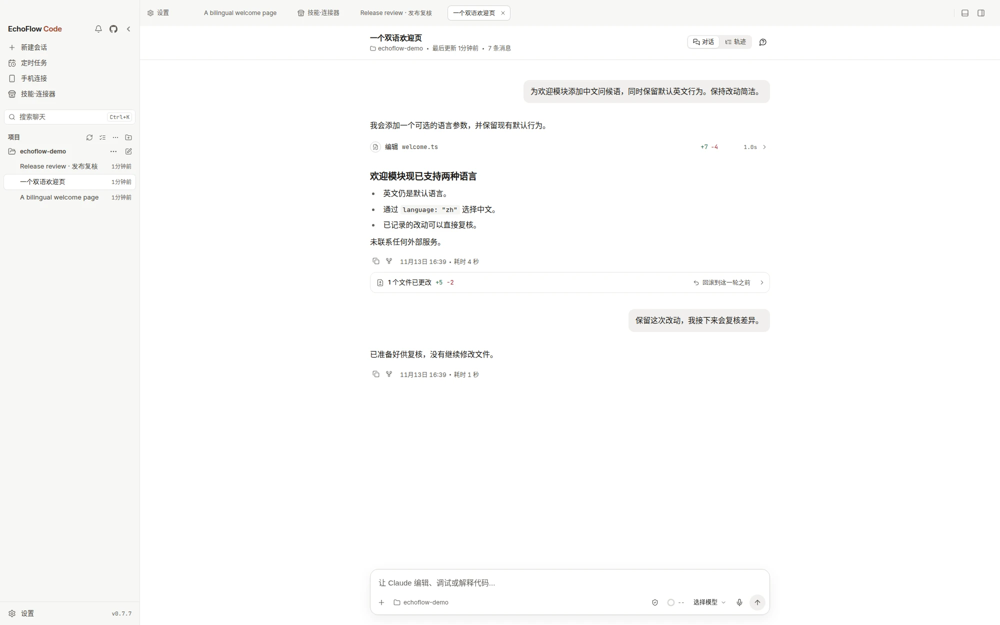
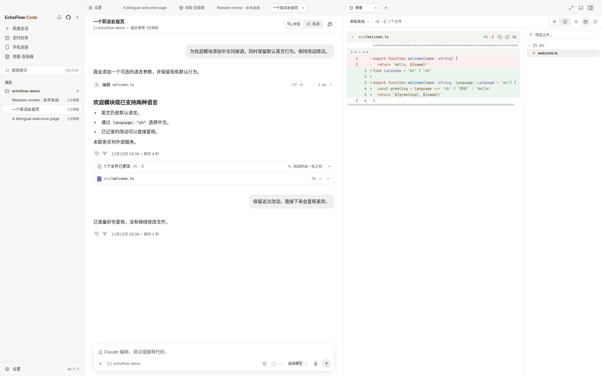
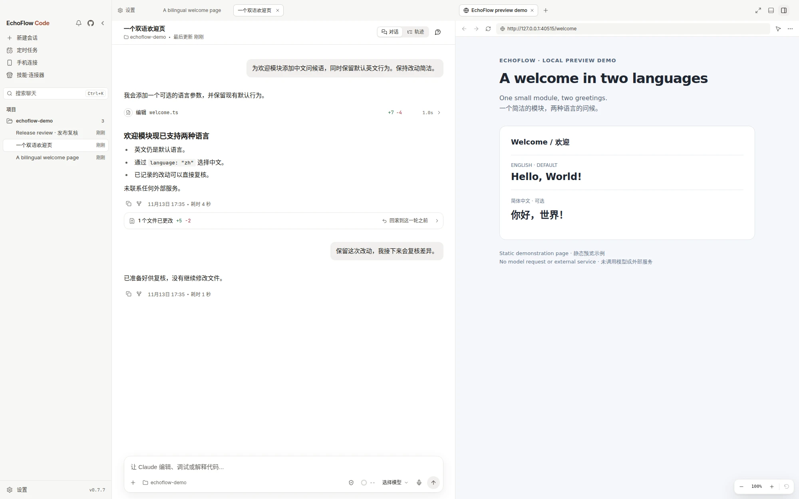
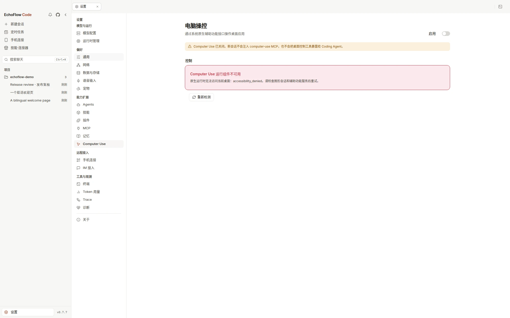
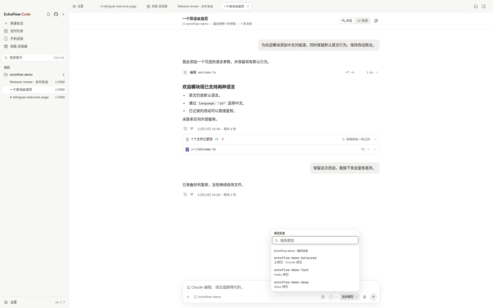
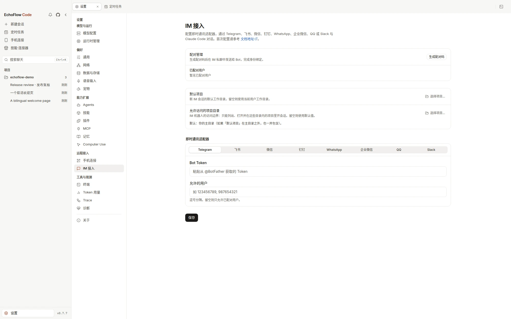

# EchoFlow Code：Claude Code 的本地优先桌面客户端

<p align="center">
  <picture>
    <source media="(prefers-color-scheme: dark)" srcset="docs/images/logo-horizontal-dark.svg">
    
  </picture>
</p>

<div align="center">

[](https://github.com/LiuGuangHS/EchoFlow-ClaudeCode/releases/latest)
[](https://code.echoflow.cn/download)
[](https://github.com/LiuGuangHS/EchoFlow-ClaudeCode/blob/main/LICENSE)
[](https://code.echoflow.cn)
[](README.md)

[English](README.md) · **简体中文**

</div>

**EchoFlow Code 是 Claude Code 的本地优先桌面客户端（图形界面），支持 macOS、Windows 和 Linux。** 它让编程 Agent 变得看得见、管得住：Agent Teams 在可视化画布上并行协作，可逐文件审阅改动并撤销受支持的操作，权限审批可在手机或聊天软件里完成，模型由你自己选。

[**下载桌面端**](https://code.echoflow.cn/download) · [**开始第一条会话**](https://code.echoflow.cn/start/first-session) · [查看文档](https://code.echoflow.cn) · [反馈与讨论](https://github.com/LiuGuangHS/EchoFlow-ClaudeCode/discussions)

## 一眼看懂

| | |
| --- | --- |
| **它是什么** | Claude Code 的桌面图形界面，带 Agent Teams 工作台、Dynamic Workflow 编排、逐文件 Diff 审阅、Computer Use，以及手机和聊天软件审批 |
| **支持平台** | macOS、Windows、Linux 桌面端；另有用于远程接力的 Android 客户端 |
| **模型** | Claude、ChatGPT、Grok 官方账号登录；厂商 API（有 DeepSeek、Kimi、智谱 GLM 预设）；通过 LM Studio 或 Ollama 使用本地模型；兼容的自定义端点 |
| **数据** | 本地优先。会话、设置和记忆保存在你的电脑上，项目本身不运营接收会话内容的云端后端 |
| **价格** | 可免费下载。模型调用费用由你选择的服务商收取；本地模型的成本取决于模型及运行环境 |
| **许可** | 源码公开、保留所有权利（仅限原创部分），不是开源。见[许可](#许可) |
| **界面语言** | 简体中文、繁体中文、英语、日语、韩语 |
| **官网与文档** | https://code.echoflow.cn |
| **下载** | https://code.echoflow.cn/download 或 [GitHub Releases](https://github.com/LiuGuangHS/EchoFlow-ClaudeCode/releases) |

## 特别之处

### 多 Agent 协作，看得见

**Agent Teams 工作台**把团队成员、共享任务列表、通信流和依赖泳道放在同一块画布上。被未完成前置任务卡住的任务会标成阻塞状态，每位成员可以使用各自的模型和运行时，并支持人工复核。**Dynamic Workflow** 让 Agent 当场编写编排脚本，并发或流水线调度多个子代理，提供阶段视图、中断与断点续跑。详见 [Agent Teams](https://code.echoflow.cn/desktop/agent-teams) 和 [Dynamic Workflow](https://code.echoflow.cn/desktop/dynamic-workflow)。

### 每处改动都能审阅、能撤销

权限请求、工具调用和工作区 Diff 始终可见。点开任一改动文件就是带语法高亮的 Diff，可以留行级评论，整轮可撤销，还能在内置浏览器里预览刚改完的页面。五档权限模式，从“询问权限”到“跳过权限”。详见[工作区](https://code.echoflow.cn/desktop/workspace)。

### 不抢你鼠标的 Computer Use（macOS）

macOS 14.4 及以上版本里，原生运行组件通过独立的虚拟光标在后台操作其他应用，你的真实鼠标和键盘仍归你使用（少数操作可能改变应用焦点）。Windows 的兼容执行器会移动真实鼠标，Linux 暂无执行器。启用前需要在应用内确认，并完成系统授权。详见 [Computer Use](https://code.echoflow.cn/desktop/computer-use)。

### 在手机或聊天软件里批准权限

扫码就能在手机浏览器（H5）里继续同一条会话，也可以使用 Android 客户端，或者通过 Telegram、飞书、微信、钉钉、WhatsApp、企业微信、QQ、Slack 对话并审批操作。任务在你的电脑上执行，所以桌面端需要保持运行。详见[手机 H5 与 IM 接力](https://code.echoflow.cn/desktop/remote)和 [IM 接入](https://code.echoflow.cn/im)。

### 模型自己选

可以用 Claude、ChatGPT、Grok 官方账号登录，使用 DeepSeek、Kimi、智谱 GLM 等厂商 API 预设，通过 LM Studio 或 Ollama 运行本地模型，或者连接兼容的自定义端点。凭据、模型选择和权限都由你掌控。完整的 Agent 工作流需要模型支持工具调用。详见[连接模型服务](https://code.echoflow.cn/start/models)。

## 更多桌面端功能

- **多会话工作区**：标签页、项目切换、终端入口、会话历史、归档，以及等待你处理的会话高亮。
- **全局搜索**：按 Cmd+K 搜索所有会话并跳转到匹配处。
- **分支与 Worktree 启动**：选择仓库分支，并决定用当前工作树还是隔离的 Worktree。
- **项目级指令**：支持读取项目里的 `AGENTS.md`。
- **MCP 图形化管理**：界面化增删改 MCP Server，支持 STDIO、Streamable HTTP、SSE，以及项目私有、共享、全局三种作用域。
- **技能市场**：发现、预览、安装 ClawHub 和 SkillHub 的第三方技能，来源和安全状态摆在明处。
- **可视化 SubAgent 管理**：创建并调校子代理，可选模型、工具与权限模式。
- **定时任务与用量统计**：在独立会话里执行计划任务，并查看本机 Token 使用趋势。
- **模型请求追踪**：本地记录每轮模型请求的状态与耗时，方便定位卡死或失败的调用。
- **图片生成与语音输入**：在聊天里生成和编辑图片，也可以在输入框里语音听写。
- **配置分享**：从可信的 `echoflowcode://` 链接导入服务商配置。
- **主题与宠物**：六套配色主题，可跟随系统深浅色；还有可选的桌面宠物，用动作告诉你任务进度。

## 桌面端预览

|  |  |  |
| --- | --- | --- |
| **跟着任务一步步往前**<br>工具调用与阶段进度都留在眼前 | **改了什么，逐行看清楚**<br>放大的高亮 Diff，文字和代码更清楚 | **改完当场验证**<br>内置浏览器打开真实本地页面 |

|  |  |  |
| --- | --- | --- |
| **操作其他应用**<br>Computer Use 与清晰的权限状态 | **每条会话自选模型**<br>服务商、预设和本地端点都在一个列表里 | **在聊天软件里审批**<br>把 IM 平台接到桌面端 |

## 安装桌面端

1. 前往[下载页](https://code.echoflow.cn/download)或 [Releases](https://github.com/LiuGuangHS/EchoFlow-ClaudeCode/releases) 下载 macOS、Windows 或 Linux 安装包。
2. 首次启动后，在桌面端设置里配置模型服务商、API Key 和默认模型。
3. 正式 macOS Release 需要经过签名和公证；draft 或 unsigned 临时包可能需要手动放行。Windows 未签名安装包可能出现 SmartScreen 提示，点“更多信息”后选择“仍要运行”。详见[安装指南](https://code.echoflow.cn/start/install)。

## 从源码启动 CLI

```bash
bun install
cp .env.example .env
./bin/echoflow-code
```

更多配置见[环境变量](https://code.echoflow.cn/cli/env)和[命令行安装与启动](https://code.echoflow.cn/cli)。

## 常见问题

### EchoFlow Code 免费吗？

可以免费下载。应用不包含模型服务：订阅和调用费用由你选择的服务商收取，通过 LM Studio 或 Ollama 运行的本地模型的成本取决于模型及运行环境。原创部分的源码公开可查，但 EchoFlow Code 不是开源项目（见[许可](#许可)）。

### 需要先安装 Claude Code 吗？

不需要。CLI 内核已经打进桌面端安装包，不需要 Node.js、npm 或任何全局命令。终端版本也可以从本仓库获得，见[命令行指南](https://code.echoflow.cn/cli)。

### 支持哪些操作系统？

支持 macOS、Windows 和 Linux，提供 Intel / AMD 与 ARM 版本，请在[下载页](https://code.echoflow.cn/download)选择对应安装包。后台 Computer Use 仅限 macOS。

### 能用 DeepSeek、Kimi、智谱 GLM 驱动 Claude Code 吗？

可以。EchoFlow Code 内置 DeepSeek、Kimi、智谱 GLM 的预设，也能连接 LM Studio、Ollama 或任意兼容的自定义端点。可用模型取决于你的账号和服务商，Agent 工作流需要模型支持工具调用。详见[连接模型服务](https://code.echoflow.cn/start/models)。

### 我的代码和会话数据会离开电脑吗？

会话、设置、记忆、技能和日志保存在本机，主要位于 `~/.claude`。项目本身不运营接收会话内容的云端后端。应用并非完全离线：提示词、附件、所选代码上下文和工具结果会发送给你选择的模型服务商；启用的集成及其他配置的服务也可能接收相关数据。详见[隐私与联网说明](https://code.echoflow.cn/start/privacy)。

### Computer Use 会抢我的鼠标吗？

macOS 14.4 及以上版本不会，原生运行组件使用独立的虚拟光标。Windows 的兼容执行器会移动真实鼠标，Linux 暂无执行器。详见 [Computer Use](https://code.echoflow.cn/desktop/computer-use)。

### 能在手机上批准权限吗？

可以。使用 H5 访问（扫码）、Android 客户端，或者受支持的聊天平台。任务在你的电脑上执行，所以桌面端需要保持运行。详见[手机 H5 与 IM 接力](https://code.echoflow.cn/desktop/remote)。

### 它和终端里的 Claude Code CLI 是什么关系？

桌面端是包在本仓库 `echoflow-code` CLI 内核外面的图形界面。权限审批、子 Agent、Skills、MCP 和记忆在界面里的用法与终端一致，桌面端额外提供 Diff 审阅、Agent Teams 工作台、会话历史和远程审批。

### 可以修改或再分发 EchoFlow Code 吗？

没有书面授权不可以。源码公开仅供查看和审阅，但保留所有权利：复制、修改、再分发、转授权和商用都需要另行签订书面协议。见[许可](#许可)。

## 更多文档

完整文档站：<https://code.echoflow.cn>。面向 AI 助手的机器可读索引见 [llms.txt](https://code.echoflow.cn/llms.txt)。

| 分区 | 文档 |
|------|------|
| 开始使用 | [下载与安装](https://code.echoflow.cn/start/install) · [连接模型服务](https://code.echoflow.cn/start/models) · [跑通第一条会话](https://code.echoflow.cn/start/first-session) · [故障排查](https://code.echoflow.cn/start/troubleshooting) · [隐私与联网](https://code.echoflow.cn/start/privacy) |
| 桌面端功能 | [功能总览](https://code.echoflow.cn/desktop) · [Agent Teams](https://code.echoflow.cn/desktop/agent-teams) · [Dynamic Workflow](https://code.echoflow.cn/desktop/dynamic-workflow) · [Computer Use](https://code.echoflow.cn/desktop/computer-use) · [技能与技能市场](https://code.echoflow.cn/desktop/skills) · [定时任务](https://code.echoflow.cn/desktop/schedule) · [手机 H5 与 IM 接力](https://code.echoflow.cn/desktop/remote) |
| 实战案例 | [修复 Bug](https://code.echoflow.cn/cases/fix-bug) · [读懂陌生项目](https://code.echoflow.cn/cases/explore-project) · [用手机接力会话](https://code.echoflow.cn/cases/phone-handoff) · [全部案例](https://code.echoflow.cn/cases) |
| IM 接入 | [总览](https://code.echoflow.cn/im) · [Telegram](https://code.echoflow.cn/im/telegram) · [飞书](https://code.echoflow.cn/im/feishu) · [微信](https://code.echoflow.cn/im/wechat) · [钉钉](https://code.echoflow.cn/im/dingtalk) |
| 命令行 | [安装与启动](https://code.echoflow.cn/cli) · [命令参考](https://code.echoflow.cn/cli/reference) · [环境变量](https://code.echoflow.cn/cli/env) |
| 深入原理 | [桌面端架构](https://code.echoflow.cn/internals/desktop) · [多 Agent 系统](https://code.echoflow.cn/internals/agent) · [Skills 系统](https://code.echoflow.cn/internals/skills) · [本地 Server 与 API](https://code.echoflow.cn/internals/server) · [参与贡献与质量门禁](https://code.echoflow.cn/internals/contributing) |

## 反馈与讨论

使用问题、功能想法和实践交流请到 [Discussions](https://github.com/LiuGuangHS/EchoFlow-ClaudeCode/discussions)；可复现的产品问题请提交 [Issues](https://github.com/LiuGuangHS/EchoFlow-ClaudeCode/issues)。分享日志前先看 [SUPPORT.md](SUPPORT.md)，安全漏洞请遵循 [SECURITY.md](SECURITY.md)。

## 技术栈

| 类别 | 技术 |
|------|------|
| 语言 | TypeScript |
| 桌面 APP | Electron |
| 桌面 UI | React + Vite |
| 本地运行时 | [Bun](https://bun.sh) |
| 终端 UI | React + [Ink](https://github.com/vadimdemedes/ink) |
| CLI 解析 | Commander.js |
| API | Anthropic SDK |
| 协议 | MCP, LSP |

## 许可

EchoFlow Code 是**源码公开（source-available），不是开源项目。** 本仓库原创部分的源码公开，仅供查看和审阅，但保留所有权利：复制、修改、再分发、转授权和商用都需要另行签订书面协议（见 [LICENSE](LICENSE)）。部分代码派生自第三方来源，不在该许可的覆盖范围内，见 [THIRD_PARTY_LICENSES.md](THIRD_PARTY_LICENSES.md)。Claude 和 Claude Code 是 Anthropic, PBC 的商标，EchoFlow Code 与 Anthropic 没有关联，也未获其背书。

## 致谢

- [React](https://github.com/facebook/react)：前端工程与组件化 UI 生态。
- [Electron](https://github.com/electron/electron)：跨端桌面应用能力与工程实践。
- [cc-switch](https://github.com/farion1231/cc-switch)：模型供应商配置能力参考。
