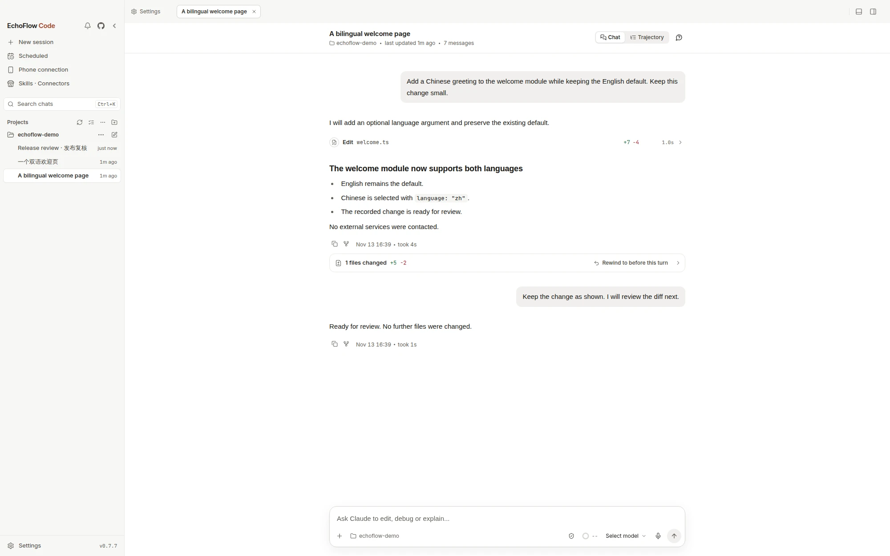

# What EchoFlow Code is

EchoFlow Code is a local-first AI coding desktop client based on Claude Code, available for macOS, Windows, and Linux. Choose a project folder and model, then describe a goal in natural language. The agent reads code, edits files, and runs commands, while the desktop workbench brings permission requests, tool calls, and file-by-file diff review together. It also provides Agent Teams, Dynamic Workflow, and phone or messaging relay that requires your computer to stay running.

That's a real session. Projects and history on the left, the conversation in the middle, and when Claude edits a file the diff appears right underneath, line by line.

## How this relates to the Claude Code CLI

Claude Code is Anthropic's command-line coding agent. EchoFlow Code provides a graphical desktop interface and bundles a CLI named `echoflow-code`. The repository's third-party notice records that the root `src/` runtime derives from Claude Code source leaked from the Anthropic npm registry on March 31, 2026. Rights to those portions remain with their original owners and are not granted by EchoFlow's license.

**Public source does not mean open source.** All rights to EchoFlow's original work are reserved; third-party portions carry separate notices, and distribution still requires legal review. Read the [license and provenance explanation](./faq.md) before using, modifying, or distributing it.

Two practical consequences:

- **You don't install Claude Code first.** The CLI engine ships inside the installer. No Node.js, no npm, no global commands.
- **Manage agent work visually.** Permission prompts, subagents, Skills, MCP, and memory have desktop controls, so you do not have to follow the task only through scrolling terminal output.

If you'd rather stay in the terminal, the CLI is still there: see [Command line](../cli/index.md).

## What it does for you

**Writes code.** Describe a goal — add a feature, fix a bug, restyle a page — and it finds the files, reads the surrounding context, makes the edits, and tells you which files it touched.

**Shows its work.** Every edit comes with an inline diff, and the workspace panel on the right collects everything changed this turn into a list you can open file by file. Don't like it? Send it back.

**Delegates.** Big tasks can be split across subagents running in parallel, with their progress visible in the activity panel. You can also give each agent its own model, tools, and system prompt.

**Runs on a schedule.** Tidy up logs every morning, audit dependencies every week — set a job on a schedule and it clocks in on its own, leaving a record of each run.

**Follows you to your phone.** Turn on H5 access, scan a QR code, and pick the conversation back up on your phone. Or connect Telegram, Feishu, or WeChat and drive it from a chat window.

## Three commitments

**Local first, not fully offline.** Sessions, settings, memory, and skills are primarily stored on your machine. The project does not operate a cloud backend that receives session content. However, prompts, selected code context, and tool results go to your chosen model service; MCP, messaging, relays, updates, and the upstream runtime can also use the network. Account sign-in still authenticates with the relevant service. See [Privacy and network access](./privacy.md).

**Your choice of model.** Use official Claude, ChatGPT, or Grok sign-in, API presets for DeepSeek, Kimi, or Zhipu GLM, or local models via LM Studio and Ollama. EchoFlow SiHub account access is another option. Availability and costs depend on the provider, account, and hardware; local task execution also depends on tool calling and API compatibility. See [Connect a model](./models.md).

**Permission-controlled execution, reviewable changes.** The default "Ask permissions" mode confirms edits and higher-risk commands when the CLI requests it. Modes such as auto-accept edits reduce prompts; not every write requires a click. To change modes, wait for the current turn to finish or stop it first. See [Sessions and permissions](../desktop/sessions.md).

## Start here

Work through these in order; about twenty minutes gets you to a working first session.

1. [Download and install](./install.md) — installers for all three platforms, and what to do when the OS blocks them.
2. [Connect a model](./models.md) — official accounts, third-party APIs, or local models. Pick one.
3. [Run your first session](./first-session.md) — pick a folder, set permissions, state a goal, watch it work, review the diff.
4. [Desktop feature map](../desktop/index.md) — once it's running, see what else is in the box.

For a goal you can practice end to end, continue with the [practical guides](../cases/index.md): explore an unfamiliar project, fix a bug, preview a page, schedule a review, and continue on your phone.

For installation, model costs, offline use, licensing, and platform support, see the [FAQ](./faq.md). Stuck along the way? [Won't install, won't open, won't connect](./troubleshooting.md) is organized by symptom.
