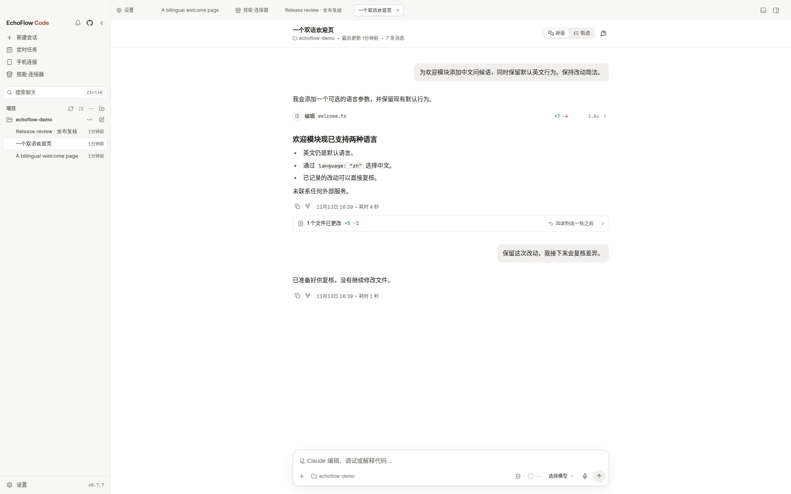

# EchoFlow Code 是什么

EchoFlow Code 是基于 Claude Code 的本地优先 AI 编程桌面客户端，支持 macOS、Windows 和 Linux。你选择项目文件夹和模型，用自然语言提出目标，Agent 读取代码、编辑文件、运行命令；桌面端把权限请求、工具调用和逐文件 Diff 审阅放进同一个工作台。它还提供 Agent Teams、Dynamic Workflow，以及需要电脑保持运行的手机与 IM 接力。

上图是一条真实会话：左边是项目和历史，中间是对话，Claude 读完文件后直接改，改了什么就在下面逐行标出来。

## 和 Claude Code CLI 是什么关系

Claude Code 是 Anthropic 的命令行编程 Agent。EchoFlow Code 提供桌面图形界面，并随安装包提供名为 `echoflow-code` 的 CLI。仓库的第三方声明记录了根目录 `src/` 运行时源自 Anthropic npm registry 于 2026 年 3 月 31 日泄露的 Claude Code 源码；这些部分的权利仍属于原权利人，不由 EchoFlow 的许可授予。

**源码公开不等于开源。** EchoFlow 原创部分保留所有权利；第三方部分另受其声明约束，分发仍需法律审查。使用、修改或分发前，请阅读[许可与来源说明](./faq.md)。

对你来说，这意味着两件事：

- **不用先装 Claude Code。** CLI 内核已经打进安装包，装完应用就能用，不需要 Node.js、npm 或任何全局命令。
- **用界面管理 Agent 工作。** 权限审批、子 Agent、Skills、MCP 和记忆都有对应的桌面操作入口，不必只靠滚动的终端输出跟踪任务。

想直接用终端的人也没被落下，源码里的 CLI 一直在，见 [命令行](../cli/index.md)。

## 它能帮你做什么

**写代码。** 描述一个目标——加个功能、修个 bug、换套配色——它自己找文件、读上下文、动手改，改完告诉你动了哪几个文件。

**审改动。** 每次编辑都带一份内联 diff，右侧工作区还会把这一轮改过的文件列成清单，能逐个点开左右对照。不满意就打回去重改。

**派 Agent。** 大任务可以拆给子 Agent 并行跑，你在活动面板里看它们各自的进度。也可以在设置里给不同 Agent 配不同的模型、工具和系统提示词。

**定时跑。** 每天早上整理一次日志、每周跑一遍依赖检查——把任务设成定时的，到点它自己开工，跑完留一份记录。

**手机上继续。** 开一次 H5 访问，扫码就能在手机上接着刚才那条会话；也可以把飞书、Telegram、微信这些聊天软件接上，在对话框里指挥它干活。

## 三条底线

**本地优先，而非完全离线。** 会话、设置、记忆、技能主要保存在本机，项目不运营接收会话内容的云端后端。但提示词、所选代码上下文和工具结果会发给你选择的模型服务；MCP、IM、中继、更新及上游运行时也可能联网。使用账号登录时仍涉及对应服务的认证，详见[隐私与联网说明](./privacy.md)。

**模型自选。** 支持 Claude、ChatGPT、Grok 官方账号登录，DeepSeek、Kimi、智谱 GLM 等 API 预设，以及 LM Studio、Ollama 本地模型；也可选择 EchoFlow SiHub 账号接入。可用模型与费用取决于服务商、账号和硬件，本地模型能否执行任务还取决于工具调用能力与接口兼容性，见[连接模型服务](./models.md)。

**按权限模式执行，改动可审阅。** 默认「询问权限」会在 CLI 请求时确认编辑和高风险命令；自动接受编辑等模式会减少询问，不代表每次写入都要你点头。要调整模式，请等当前轮结束或先停止，再按[会话与权限说明](../desktop/sessions.md)操作。

## 从这里开始

按顺序走，大约二十分钟能跑通第一条会话：

1. [下载与安装](./install.md) — 三个平台的安装包，以及系统拦下来时怎么办。
2. [连接模型服务](./models.md) — 官方账号、第三方 API、本地模型，三种接法挑一种。
3. [跑通第一条会话](./first-session.md) — 选目录、选权限、说目标、看它干活、审改动。
4. [桌面端功能地图](../desktop/index.md) — 跑通之后，看看还有哪些能力可以用上。

想带着具体目标练习，接着看[实战案例](../cases/index.md)：从读懂陌生项目到修 Bug、预览页面、定时审查和手机接力。

安装、模型费用、离线使用、许可和平台支持的常见疑问，见[常见问题 FAQ](./faq.md)。中途卡住了，去 [装不上 / 打不开 / 连不上](./troubleshooting.md) 按症状找。
